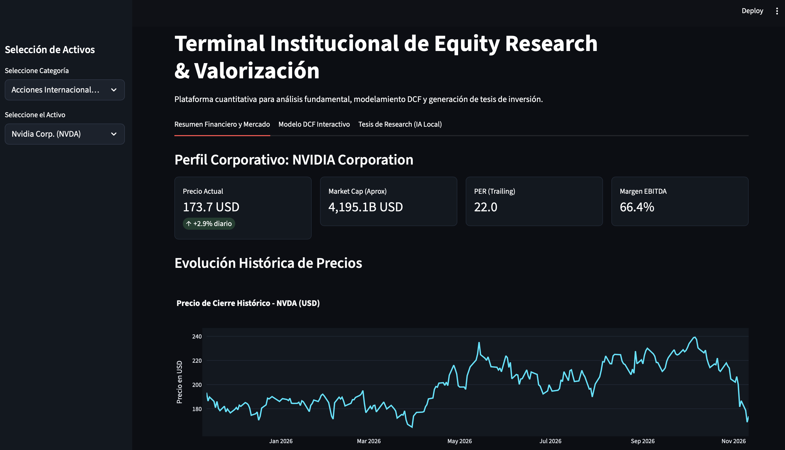
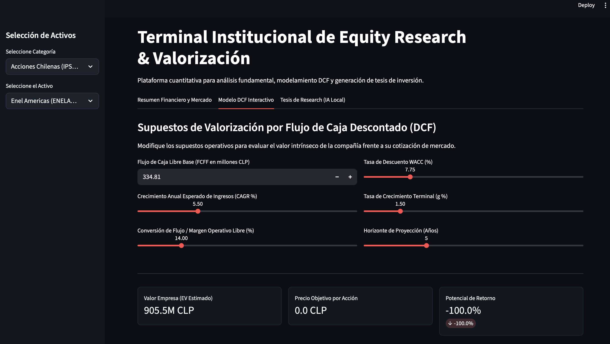

# Institutional Equity Research & Valuation Terminal

Plataforma cuantitativa y terminal fintech desarrollada en Python y Streamlit, diseñada para automatizar el análisis fundamental de activos financieros (acciones del IPSA chileno, renta variable internacional, bonos y proxies de renta fija), modelamiento dinámico de Flujo de Caja Descontado (DCF) y síntesis automatizada de tesis de inversión mediante Inteligencia Artificial Local (Ollama / Llama 3).

---

## Vista Previa de la Interfaz (Dark Mode Corporativo)

### 1. Resumen Financiero y Perfil de Mercado (Vista General)
El terminal integra métricas corporativas clave en tiempo real, barras laterales con selectores limpios estructurados por categorías de activos y gráficos interactivos de alta precisión en azul neón.
> 

### 2. Modelo DCF Interactivo (Valorización por Flujos de Caja)
Permite realizar escenarios de sensibilidad ajustando dinámicamente el WACC, la tasa terminal (g), el crecimiento de ingresos (CAGR) y el margen operativo para calcular el valor empresa (EV) y el precio objetivo por acción.
> 

### 3. Generación de Research Automatizado (IA Local)
Módulo especializado que sintetiza los fundamentos de la compañía y calcula matrices de riesgo institucional ejecutándose de manera privada y offline mediante modelos de lenguaje locales.
> 

---

## Stack Tecnológico y Arquitectura
- Lenguaje: Python 3.10+
- Interfaz Web: Streamlit (Optimizada para Layout Wide y modo oscuro corporativo).
- Procesamiento Cuantitativo: Pandas, NumPy.
- Motores de Datos Financieros: yfinance (Yahoo Finance API en tiempo real).
- Visualización Avanzada: Plotly (Gráficos interactivos responsivos).
- IA y Procesamiento de Lenguaje Natural: Ollama (Llama 3 ejecutado en Edge / Localhost).

---

## Insights de Valor y Ventajas Competitivas del Modelo

Este dashboard no es simplemente un visualizador de datos estático, sino una herramienta de Front Office diseñada bajo estándares institucionales que aporta los siguientes insights de valor:

1. Gestión de Datos Multi-Activo Categorizada:
   - Agrupa con sufijos de moneda explícitos activos locales (SQM, Banco de Chile, BCI, Cencosud, etc.), benchmarks internacionales (Apple, Nvidia, Microsoft), instrumentos de renta fija global y tasas de corto plazo (proxies de Depósitos a Plazo / DAP).
2. Modelamiento DCF Dinámico y Riguroso:
   - Implementa el Gordon Growth Model acoplado a un horizonte de proyección ajustable (3 a 10 años), calculando de forma automatizada el valor presente de los flujos de caja libres (FCFF), el valor terminal descontado y el diferencial porcentual de retorno frente al precio de mercado actual.
3. Privacidad y Computación Edge (IA Local):
   - Al integrar Ollama, el sistema redacta tesis de inversión y matrices de riesgo institucional de manera 100% offline. Esto elimina la dependencia de APIs pagadas en la nube, garantizando confidencialidad de datos y demostrando dominio avanzado en despliegue de modelos locales (Edge LLMs).
4. Diseño Visual de Alta Gama (Business Dark Mode):
   - Interfaz optimizada para mitigar la fatiga visual en largas jornadas de análisis bursátil, cuidando el contraste estricto (fondo oscuro corporativo con tipografía blanca y menús desplegables estilizados) y evitando truncamientos numéricos para asegurar un estándar profesional impecable.

---


## Ejecución Local
1. Clonar el repositorio e instalar dependencias:
   ```bash
   pip install -r requirements.txt
2. streamlit run app.py
