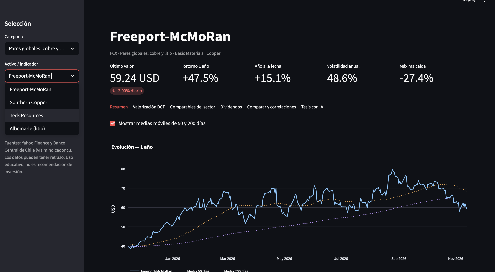
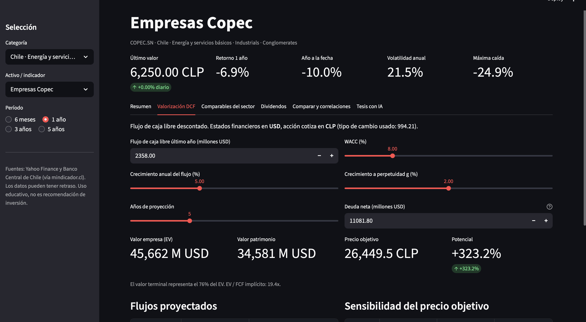
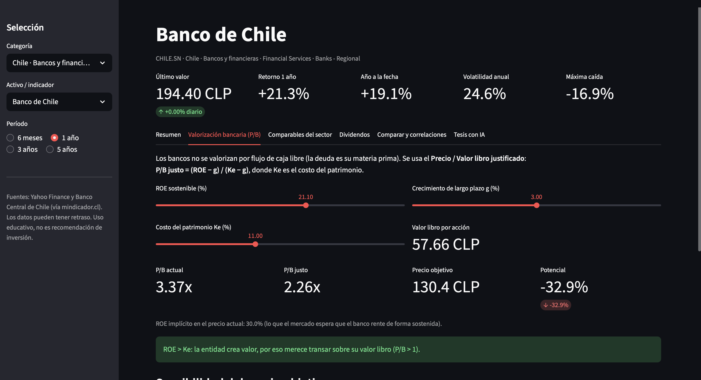
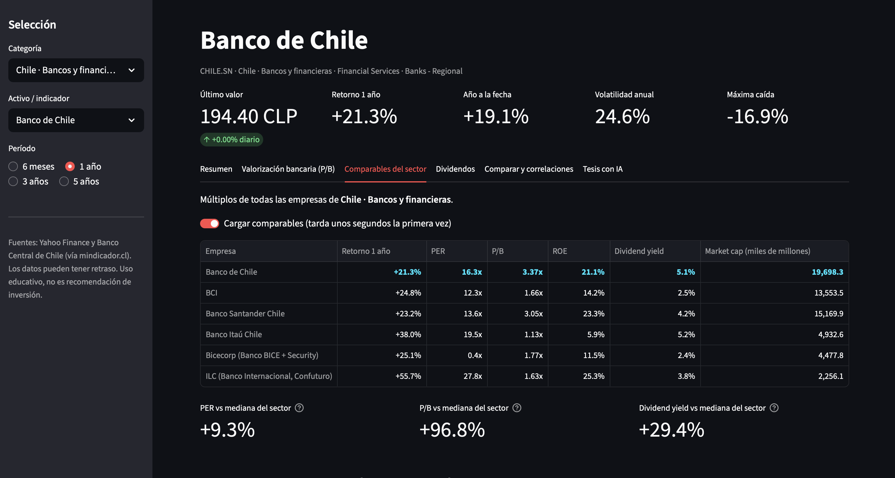
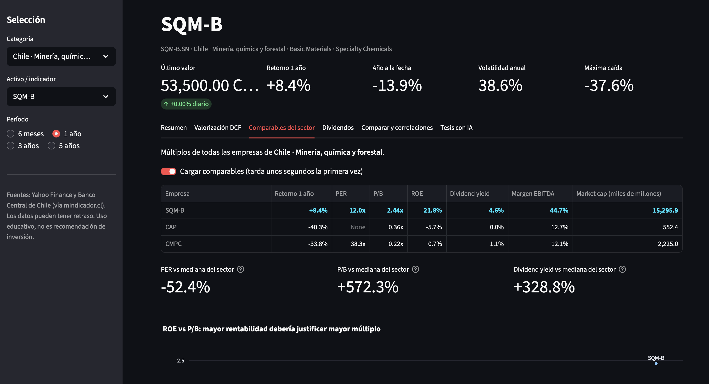
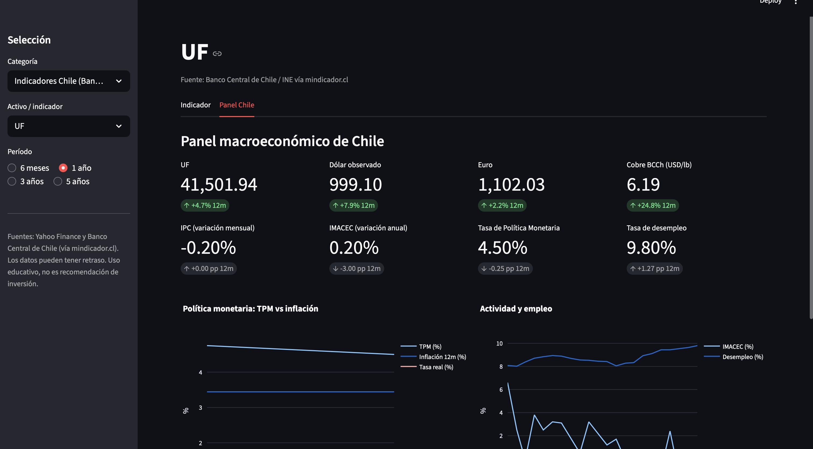

# Terminal de Equity Research — Chile y Mercados Globales

Aplicación web en Python y Streamlit para analizar y valorizar el mercado chileno en su contexto global. Reúne las acciones del IPSA por sector, bancos chilenos e internacionales, pares globales de cobre y litio, ETFs, variables macro globales e indicadores del Banco Central de Chile. Cada tipo de activo usa el método de valorización que le corresponde.

**🔗 Demo en vivo:** [LINK_A_TU_APP.streamlit.app](https://LINK_A_TU_APP.streamlit.app)


<sub>Banco de Chile (CHILE.SN): retornos, volatilidad, máxima caída y tendencia con medias móviles de 50 y 200 días.</sub>

---

## ¿Qué problema resuelve?

Analizar una acción chilena normalmente exige combinar varias fuentes: el precio en una plataforma, los estados financieros en otra, los múltiplos de la competencia en una tercera, el cobre y el dólar en otra más, y la valorización en Excel. Esta terminal reúne todo en una sola vista y permite responder preguntas como:

- ¿Cuánto vale SQM según un DCF, y qué tan sensible es ese valor al WACC?
- ¿Banco de Chile transa caro o barato frente a BCI, Santander e Itaú, considerando su ROE?
- ¿Qué ROE está descontando el mercado en el precio actual de un banco?
- ¿Qué tan correlacionada está SQM con el litio, y cómo ha cambiado esa relación en el último año?
- ¿La política monetaria del Banco Central es hoy contractiva o expansiva (TPM vs. inflación)?
- ¿Cómo afectan el cobre, China y las tasas de EE.UU. al IPSA y al peso chileno?

---

## Universo de activos

| Categoría | Activos |
|---|---|
| **Chile · Bancos y financieras** | Banco de Chile, BCI, Santander Chile, Itaú Chile, Bicecorp (BICE + Security), ILC |
| **Chile · Minería, química y forestal** | SQM-B, CAP, CMPC |
| **Chile · Energía y servicios básicos** | Copec, Enel Chile, Enel Américas, Colbún, Engie, Aguas Andinas, IAM |
| **Chile · Consumo y retail** | Falabella, Cencosud, Ripley, SMU, CCU, Andina, Concha y Toro |
| **Chile · Inmobiliario y construcción** | Parque Arauco, Mallplaza, Cencosud Shopping, SalfaCorp |
| **Chile · Transporte, telecom y holdings** | LATAM, Vapores, Entel, Quiñenco |
| **Bancos internacionales** | JPMorgan, Bank of America, Citigroup, Itaú Unibanco, Santander España, Credicorp |
| **Pares globales: cobre y litio** | Freeport-McMoRan, Southern Copper, Teck, Albemarle |
| **Acciones internacionales** | Apple, Microsoft, Nvidia, Amazon, Alphabet, Meta, Tesla |
| **ETFs** | Chile (ECH), Latinoamérica, Emergentes, S&P 500, Nasdaq, cobre, litio, oro, bonos del Tesoro, bonos emergentes, T-Bills |
| **Macro global** | IPSA, S&P 500, Bovespa, Shanghai, USD/CLP, USD/BRL, USD/CNY, cobre, WTI, Brent, oro, tasas EE.UU. 3m y 10a, DXY, VIX |
| **Indicadores Chile (Banco Central)** | UF, dólar observado, euro, cobre, IPC, IMACEC, TPM, desempleo |

---

## Módulos de análisis

### 1. Resumen: rentabilidad, riesgo, técnico y fundamentales


<sub>Freeport-McMoRan (FCX), par global del cobre para comparar con las mineras chilenas: +47,5% en un año con 48,6% de volatilidad.</sub>

Para cualquier activo:

- **Rentabilidad y riesgo**: retornos a 1 mes, 3 meses, año a la fecha y 1 año; volatilidad anualizada y máxima caída.
- **Técnico**: medias móviles de 50 y 200 días, RSI de 14 días, tendencia y distancia al máximo de 52 semanas.
- **Fundamentales** (acciones y bancos): PER, P/B, ROE, dividend yield, margen EBITDA y endeudamiento.

### 2. Valorización DCF (empresas)



Proyecta el flujo de caja libre, lo descuenta al WACC y agrega un valor terminal con crecimiento a perpetuidad (modelo de Gordon):

```
EV = Σ FCFₜ / (1 + WACC)ᵗ  +  [FCFₙ × (1 + g) / (WACC − g)] / (1 + WACC)ⁿ
Valor patrimonio = EV − Deuda neta
Precio objetivo = Valor patrimonio / Acciones en circulación × Tipo de cambio
```

- **Deuda neta** (deuda financiera menos caja) precargada desde los estados financieros y editable.
- **Conversión de moneda automática**: SQM, CAP y LATAM, por ejemplo, reportan en USD pero cotizan en CLP.
- **Tabla de sensibilidad** del precio objetivo ante cambios en WACC y g.
- Muestra qué porcentaje del EV viene del valor terminal, y el múltiplo EV/FCF implícito.
- Avisa cuando el flujo de caja libre es negativo y el DCF deja de ser confiable.

### 3. Valorización bancaria (P/B justificado)



En un banco la deuda es materia prima del negocio y no una fuente de financiamiento, así que el DCF tradicional no aplica. Se usa el múltiplo Precio / Valor libro justificado:

```
P/B justo = (ROE − g) / (Ke − g)
Precio objetivo = P/B justo × Valor libro por acción
ROE implícito = g + P/B de mercado × (Ke − g)
```

- Si el ROE supera al costo del patrimonio (Ke), el banco crea valor y merece transar sobre su valor libro.
- El **ROE implícito** muestra qué rentabilidad sostenida está descontando el mercado en el precio actual.
- Incluye una tabla de sensibilidad ROE × Ke.

### 4. Comparables del sector



Tabla de múltiplos (PER, P/B, ROE, dividend yield, margen EBITDA, capitalización y retorno a 1 año) de todas las empresas del mismo grupo. Destaca la empresa analizada, calcula su diferencia contra la mediana del sector y grafica **ROE vs. P/B** para identificar empresas caras o baratas en relación con su rentabilidad.

### 5. Dividendos

Historial de dividendos por acción de los últimos 10 años y dividend yield de los últimos 12 meses. Es especialmente relevante en Chile, donde las sociedades anónimas abiertas deben repartir al menos el 30% de su utilidad.

### 6. ETFs, comparación y correlaciones


<sub>Nasdaq 100 (QQQ): los ETFs y las variables macro tienen su propio análisis de rentabilidad, riesgo y comparación.</sub>

- Desempeño relativo en **base 100** contra cualquier otro activo del universo.
- **Matriz de correlación** de retornos diarios.
- **Correlación móvil de 60 días**, que muestra cómo cambia la relación en el tiempo (por ejemplo, SQM vs. litio o IPSA vs. cobre).



Cada categoría trae comparaciones sugeridas: las mineras se comparan con el cobre, el dólar y el litio; los bancos, con sus pares; las eléctricas, con el petróleo y las tasas.

### 7. Panel Chile (Banco Central)



Series oficiales del Banco Central de Chile y del INE, obtenidas desde la API pública de [mindicador.cl](https://mindicador.cl):

- Último dato y variación a 12 meses de UF, dólar, euro, cobre, IPC, IMACEC, TPM y desempleo.
- **Inflación acumulada a 12 meses** calculada desde el IPC mensual.
- **TPM vs. inflación y tasa real**: indica si la política monetaria es contractiva o expansiva.
- **IMACEC vs. desempleo**: actividad económica y mercado laboral.

### 8. Tesis de inversión con IA local (opcional)

Si se ejecuta en local con [Ollama](https://ollama.com) y Llama 3, la app redacta un borrador de tesis a partir de los datos, la valorización calculada y el contexto macro de Chile, sin enviar información a APIs externas. En la versión web este módulo está desactivado.

---

## Tecnologías

- **Python** · pandas · NumPy
- **Streamlit**: interfaz web y despliegue en Streamlit Community Cloud
- **yfinance**: precios, fundamentales y dividendos desde Yahoo Finance
- **mindicador.cl**: indicadores del Banco Central de Chile (API pública, sin clave)
- **Plotly**: gráficos interactivos
- **Ollama / Llama 3**: IA local (opcional)

---

## Ejecución local

```bash
git clone https://github.com/camilojosemorales2002/NOMBRE_DEL_REPO.git
cd NOMBRE_DEL_REPO
pip install -r requirements.txt
streamlit run app.py
```

Para activar la tesis con IA (opcional):

```bash
pip install ollama
ollama pull llama3
```

---

## Estructura

```
├── app.py                  # Aplicación completa
├── requirements.txt        # Dependencias
├── .streamlit/config.toml  # Tema oscuro
└── *.png                   # Capturas del README
```

---

## Limitaciones

- Los datos de Yahoo Finance pueden tener retraso, y algunos fundamentales de acciones chilenas no están disponibles (aparecen como N/A).
- BancoEstado no cotiza en bolsa, por lo que no forma parte del universo. Banco Security se analiza a través de Bicecorp tras la fusión de ambos grupos.
- El DCF es un modelo simplificado de una etapa de crecimiento, y el P/B justificado supone un ROE sostenible constante. Los supuestos por defecto son referenciales y deben ajustarse a cada empresa.
- Herramienta con fines educativos y de análisis; no constituye recomendación de inversión.

---

## Autor

**Camilo José Morales Carvajal**
Licenciado en Ciencias de la Administración, Universidad Adolfo Ibáñez · Magíster en Estrategia y Gestión (en curso)

[LinkedIn](https://www.linkedin.com/in/TU_URL) · [GitHub](https://github.com/camilojosemorales2002)
